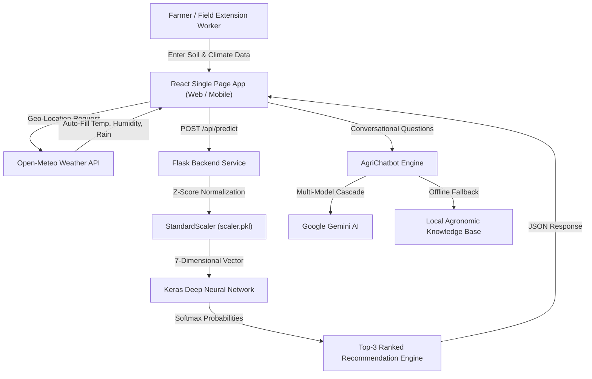

# 🌾 AgriSmart AI — Precision Agriculture & Deep Neural Crop Recommendation Platform

[](https://www.python.org/)
[](https://www.tensorflow.org/)
[](https://keras.io/)
[](https://react.dev/)
[](https://tailwindcss.com/)
[](LICENSE)
[](results/model_metrics.txt)

> **AgriSmart AI** is a full-stack, neural-network-powered agricultural decision support platform. By ingesting soil macronutrients ($N, P, K$), soil chemistry ($\text{pH}$), and localized micro-climatic parameters (Temperature, Humidity, Rainfall), the platform accurately predicts optimal crops across 22 varieties, ranks alternative crop options, provides economic viability analytics, and offers 8-language multilingual conversational intelligence.

---

## 📌 Table of Contents
- [System Architecture](#-system-architecture)
- [Key Features](#-key-features)
- [Agronomic Features & Target Classes](#-agronomic-features--target-classes)
- [Machine Learning & Deep Learning Pipeline](#-machine-learning--deep-learning-pipeline)
- [Jupyter Notebooks](#-jupyter-notebooks)
- [Project Directory Structure](#-project-directory-structure)
- [Local Quickstart Installation](#-local-quickstart-installation)
- [Free Cloud Deployment (Render.com)](#-free-cloud-deployment-rendercom)
- [API Reference](#-api-reference)
- [License & Contributions](#-license--contributions)

---

## 🏛 System Architecture

The platform is designed with a decoupled, high-performance architecture:
1. **Frontend:** React + Tailwind CSS with responsive mobile-first UI, Lucide icons, speech synthesis/recognition, and full i18n localization.
2. **Backend API:** Flask REST API with Gunicorn WSGI production serving.
3. **Inference Engine:** Keras Deep Neural Network (DNN) + Scikit-Learn feature transformers.
4. **Conversational Layer:** Hybrid AI assistant leveraging Google Gemini Flash with automatic fallback to local rule-based agricultural guidance.



---

## 🚀 Key Features

* **🧠 Deep Neural Network Classifier:** Achieves **97.73% test accuracy** on empirical agricultural benchmark records across 22 crop classes.
* **🏆 Top-3 Ranked Alternatives:** Calculates full Softmax probability distribution and delivers secondary/tertiary crop alternatives with confidence percentages.
* **🌐 8-Language Multilingual Localization:** Seamless real-time language switching across the entire platform:
  * English, Hindi (हिन्दी), Punjabi (ਪੰਜਾਬੀ), Marathi (मराठी), Telugu (తెలుగు), Tamil (தமிழ்), Bengali (বাংলা), and Gujarati (ગુજરાતી).
* **🤖 AgriChatbot Voice & Text Assistant:** Multilingual conversational agent powered by Google Gemini with voice input (speech recognition) and audio playback for field accessibility.
* **📍 Geolocation & Live Weather Auto-Fill:** Automatically detects current district GPS coordinates and populates live temperature, humidity, and rainfall via meteorological APIs.
* **💰 Economic Yield & Cultivation Studio:** Detailed agronomic timelines (sowing to harvest), water/irrigation budgets, and market price insights for every recommended crop.
* **📄 Professional Soil Analysis & Recommendation Report:** Clean, print-ready agronomic reports designed for extension workers and farmers.

---

## 🧪 Agronomic Features & Target Classes

### Input Parameters (7 Features)
| Parameter | Feature Name | Agronomic Significance | Standard Range |
| :--- | :--- | :--- | :--- |
| **Nitrogen ($N$)** | `N` | Leaf development, chlorophyll synthesis, vegetative biomass | $0 - 140\text{ kg/ha}$ |
| **Phosphorus ($P$)** | `P` | Root establishment, early flowering, seed maturation | $5 - 145\text{ kg/ha}$ |
| **Potassium ($K$)** | `K` | Osmotic regulation, disease resistance, stomatal control | $5 - 205\text{ kg/ha}$ |
| **Temperature** | `temperature` | Enzymatic activity and metabolic growth rate | $8.8^\circ\text{C} - 43.7^\circ\text{C}$ |
| **Humidity** | `humidity` | Transpiration rate and atmospheric vapor pressure | $14.3\% - 99.9\%$ |
| **Soil $\text{pH}$** | `ph` | Nutrient bioavailability and microbial activity | $3.5 - 9.9\text{ pH}$ |
| **Rainfall** | `rainfall` | Natural precipitation and soil moisture reservoir | $20.2 - 298.6\text{ mm}$ |

### Supported Crops (22 Classes)
```
apple, banana, blackgram, chickpea, coconut, coffee, cotton, grapes, jute,
kidneybeans, lentil, maize, mango, mothbeans, mungbean, muskmelon, orange,
papaya, pigeonpeas, pomegranate, rice, watermelon
```

---

## 🔬 Machine Learning & Deep Learning Pipeline

### Model Architecture
```
Layer (type)                 Output Shape              Param #   Activation
===========================================================================
input_agronomic_features     (None, 7)                 0         -
dense_features_64 (Dense)    (None, 64)                512       ReLU (He Normal)
dropout_1 (Dropout)          (None, 64)                0         (Rate = 0.20)
dense_features_32 (Dense)    (None, 32)                2,080     ReLU (He Normal)
dropout_2 (Dropout)          (None, 32)                0         (Rate = 0.20)
dense_features_16 (Dense)    (None, 16)                528       ReLU (He Normal)
crop_probability_output      (None, 22)                374       Softmax
===========================================================================
Total params: 10,484 (40.96 KB)
Trainable params: 3,494 (13.65 KB)
```

### Loss & Optimization Formulation
* **Loss Function:** Sparse Categorical Cross-Entropy:
  $$\mathcal{L} = -\sum_{i=1}^{C} y_i \log(\hat{y}_i)$$
* **Optimization:** Adam ($\alpha = 0.001, \beta_1 = 0.9, \beta_2 = 0.999$).
* **Regularization:** Dual Dropout ($p=0.20$) + EarlyStopping monitoring validation loss with best weights restoration.

### Test Set Benchmark Metrics
| Metric | Value |
| :--- | :--- |
| **Total Test Samples** | 440 (Stratified 20% split) |
| **Overall Test Accuracy** | **97.73%** |
| **Sparse Cross-Entropy Loss** | **0.0588** |
| **Macro Average F1-Score** | **0.9772** |
| **Weighted Average Precision** | **0.9787** |

---

## 📓 Jupyter Notebooks

A fully documented, publication-grade notebook is available under `notebooks/`:

* **`notebooks/01_crop_recommendation_model_development.ipynb`**
  * **Section 1:** Mathematical Problem Formulation & Agricultural Theory
  * **Section 2:** Ingestion & Schema Auditing
  * **Section 3:** Comprehensive EDA (distributions, correlation heatmaps, boxplots)
  * **Section 4:** Target Label Encoding & StandardScaler Normalization
  * **Section 5:** Keras Sequential DNN Construction
  * **Section 6:** Training with EarlyStopping & Learning Curves
  * **Section 7:** Model Diagnostics (22x22 Confusion Matrix, Precision/Recall Breakdown)
  * **Section 8:** Top-3 Ranked Production Inference Engine
  * **Section 9:** Serialization (`.keras`, `.pkl`, metrics)

---

## 📁 Project Directory Structure

```
Crop_Pred/
├── app.py                      # Flask backend API + unified SPA static server
├── serve_frontend.py           # Standalone development proxy server
├── start_agrismart.bat         # One-click Windows startup script
├── Procfile                    # Production cloud process definition
├── requirements.txt            # Python dependencies (optimized for cloud)
├── .env.example                # Environment variables template
├── models/
│   ├── crop_recommendation_model.keras  # Trained Keras Neural Network
│   ├── scaler.pkl              # Fitted StandardScaler transformer
│   └── label_encoder.pkl       # Fitted LabelEncoder class mappings
├── data/
│   └── dataset/
│       └── Crop_recommendation.csv      # Empirical agricultural dataset
├── notebooks/
│   ├── 01_crop_recommendation_model_development.ipynb  # Documented notebook
│   └── crop_recommendation.ipynb                       # Working notebook
├── results/
│   ├── model_metrics.txt       # Benchmark evaluation report
│   └── prediction_history.json # Local persistent predictions log
├── project_documentation/
│   ├── diagrams/               # High-res architecture & workflow diagrams
│   └── screenshots/            # UI screenshots & walkthroughs
└── frontend/                   # React + Vite + Tailwind source
    ├── src/
    │   ├── components/         # UI cards, forms, chatbot, visualizers
    │   ├── i18n.js             # 8-language dictionary
    │   └── App.jsx
    └── dist/                   # Production-compiled assets
```

---

## 💻 Local Quickstart Installation

### Prerequisites
* Python 3.10, 3.11, or 3.12
* Node.js 18+ (only if modifying frontend code)

### 1. Clone Repository & Create Virtual Environment
```bash
git clone https://github.com/<your-username>/AgriSmart-AI.git
cd AgriSmart-AI

# Create virtual environment
python -m venv venv

# Activate virtual environment
# Windows:
.\venv\Scripts\activate
# Linux / macOS:
source venv/bin/activate
```

### 2. Install Dependencies
```bash
pip install -r requirements.txt
```

### 3. Configure Environment Variables
```bash
cp .env.example .env
# Open .env and add your GEMINI_API_KEY (optional, fallback engine active by default)
```

### 4. Run Application
**Option A: Windows 1-Click Startup:**
Double-click `start_agrismart.bat`

**Option B: Standard Command Line:**
```bash
python app.py
```
Open **`http://localhost:5000`** in your browser!

---

## ☁️ Free Cloud Deployment (Render.com)

Deploy AgriSmart AI in 3 minutes with **zero cost** and **no credit card required**:

1. **Push your code to GitHub:**
   ```bash
   git init
   git add .
   git commit -m "feat: complete AgriSmart AI platform"
   git remote add origin https://github.com/<your-username>/AgriSmart-AI.git
   git branch -M main
   git push -u origin main
   ```
2. **Create Web Service on Render:**
   * Go to [render.com](https://render.com) and sign in with GitHub.
   * Click **New +** $\rightarrow$ **Web Service**.
   * Select your `AgriSmart-AI` repository.
3. **Configure Settings:**
   * **Name:** `agrismart-ai`
   * **Runtime:** `Python 3`
   * **Build Command:** `pip install -r requirements.txt`
   * **Start Command:** `gunicorn --workers 1 --threads 4 --timeout 120 app:app`
   * **Plan:** Free
4. **Environment Variables (Optional):**
   * Add `GEMINI_API_KEY` with your key from [Google AI Studio](https://aistudio.google.com/).
5. Click **Deploy Web Service**! Your live URL (e.g., `https://agrismart-ai.onrender.com`) will be active 24/7.

---

## 📡 API Reference

### Health Check
* **`GET /api/health`**
  ```json
  {
    "status": "healthy",
    "model_loaded": true,
    "classes_count": 22,
    "gemini_active": true
  }
  ```

### Predict Crop
* **`POST /api/predict`**
  * **Payload:**
    ```json
    {
      "N": 90,
      "P": 42,
      "K": 43,
      "temperature": 20.87,
      "humidity": 82.0,
      "ph": 6.5,
      "rainfall": 202.93
    }
    ```
  * **Response:**
    ```json
    {
      "recommended_crop": "rice",
      "confidence": 98.45,
      "top_3_recommendations": [
        {"crop": "rice", "confidence": 98.45},
        {"crop": "jute", "confidence": 1.20},
        {"crop": "coffee", "confidence": 0.25}
      ],
      "agronomic_profile": { ... }
    }
    ```

### Conversational Agronomic Assistant
* **`POST /api/chat`**
  * **Payload:** `{"message": "Dhaan mein khad kitna daalein?", "language": "hi"}`
  * **Response:** Rich localized response with action pills and agronomic advice.

---

## 📄 License & Contributions

This project is licensed under the **MIT License** — see the [LICENSE](LICENSE) file for details.

Contributions, bug reports, and pull requests are warmly welcomed! 🌿
